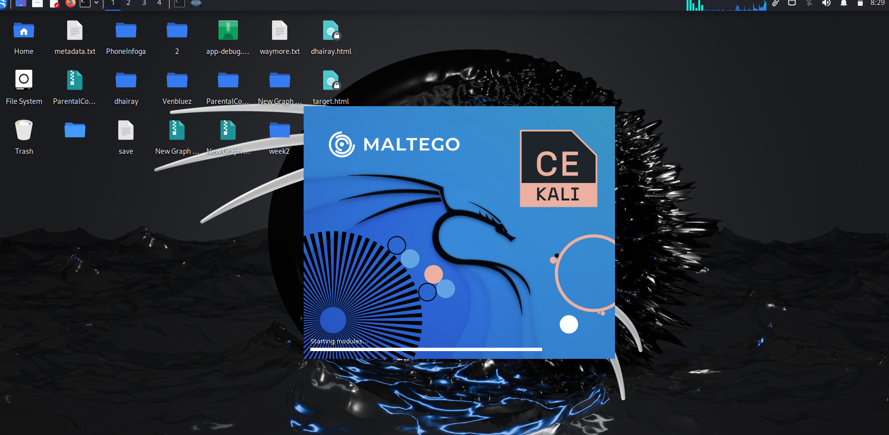
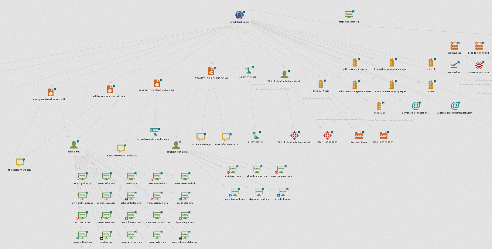
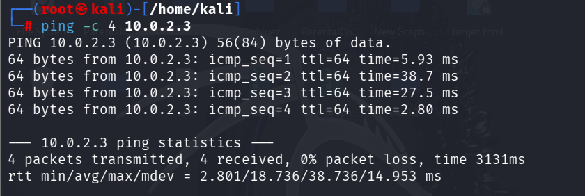
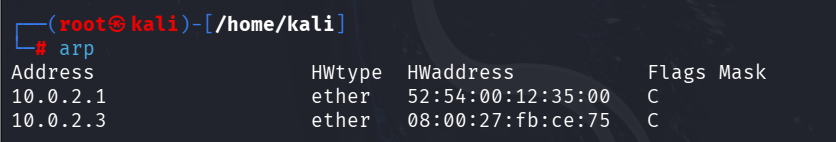
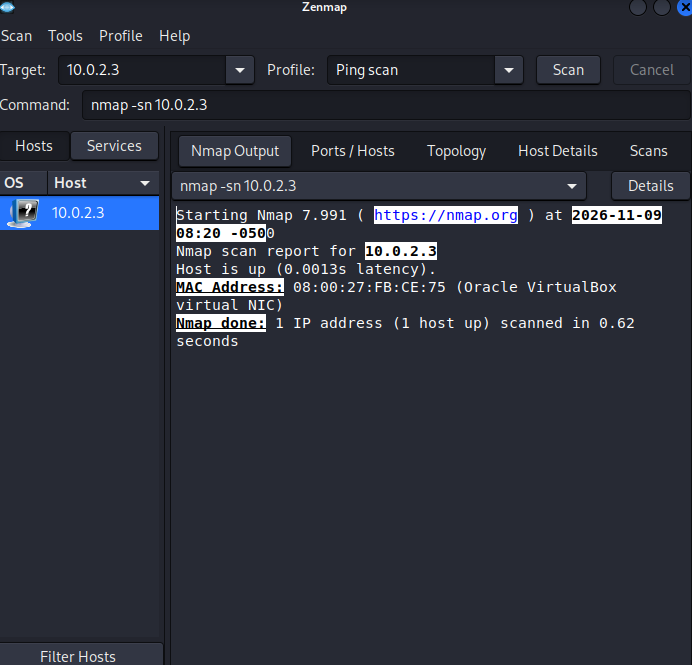

# 🔐Week 2: Penetration Testing, Footprinting and Network Scanning

**Networkwalks Cybersecurity Internship — Week 2**

This repository documents the practical activities completed during Week 2 of the Networkwalks Cybersecurity Internship.

## Completed Modules

- **W2-PM3:** Maltego Footprinting
- **W2-PM5:** Zenmap Network Scanning (Ping, ARP and Nmap Host Discovery)
- **W2-PM-FINAL:** Penetration Testing Report

**Full Report:** [W2-PM-FINAL-Report.pdf](W2-PM-FINAL-Report.pdf)

---

## Disclaimer

All activities were performed using publicly available information and an authorized VirtualBox lab environment for educational purposes.

Personal names, phone numbers and other identifiable information visible in the Maltego screenshots have been redacted.

No unauthorized access or exploitation was performed.

## Tools and Technologies

| Tool                    | Purpose                       |
| ----------------------- | ----------------------------- |
| Kali Linux (VirtualBox) | Practical environment         |
| Maltego CE              | Visual OSINT and footprinting |
| ping                    | ICMP connectivity testing     |
| ARP                     | IP-to-MAC address mapping     |
| Zenmap (Nmap 7.991)     | Network host discovery        |

---

## W2-PM3: Maltego Footprinting

**Target Domain:** `skrpublicschool.org`

**Methodology:** Passive OSINT using publicly available information.

### Activities Performed

1. Launched Maltego CE.
2. Created a new graph.
3. Added the Domain entity.
4. Executed available transforms.
5. Reviewed the discovered entities and relationships.
6. Examined the graph in entity and bubble views.

### Screenshots

**1. Maltego Application**





**2. Maltego Graph — Entity View**





**3. Maltego Graph — Bubble View**


### Observations

- Domain information was linked to Public Interest Registry and registrar PDR Ltd. (PublicDomainRegistry.com).
- Registrar-related contact information was identified.
- Publicly available documents revealed metadata, including person entities and software/version information.
- Some document metadata contained phone-number information, which has been redacted in the screenshots.
- Additional website and social-profile relationships appeared in the graph.

---

## W2-PM5: Network Scanning

**Environment:** Kali Linux in VirtualBox

**Lab Network:** `10.0.2.0/24`

**Target IP:** `10.0.2.3`

### 1. Ping Connectivity Test

**Command:**

```bash
ping -c 4 10.0.2.3
```

**Result:**

- 4 packets transmitted.
- 4 packets received.
- 0% packet loss.
- TTL: 64.
- Average response time: 18.736 ms.

**Screenshot:**





### 2. ARP Table Inspection

**Command:**

```bash
arp
```

The ARP table was inspected to identify IP-to-MAC address mappings available in the local network's ARP cache.

| IP Address | MAC Address         | Observation            |
| ---------- | ------------------- | ---------------------- |
| 10.0.2.1   | 52:54:00:12:35:00   | Lab gateway            |
| 10.0.2.3   | 08:00:27\:FB\:CE:75 | VirtualBox virtual NIC |

**Screenshot:**





### 3. Zenmap Host Discovery

**Command:**

```bash
nmap -sn 10.0.2.3
```

**Results:**

- Host status: Up
- Latency: 0.0013 seconds
- MAC address: 08:00:27\:FB\:CE:75
- MAC vendor: Oracle VirtualBox
- Hosts scanned: 1

The scan successfully identified an active host and its VirtualBox virtual network interface.

**Screenshot:**




## Key Takeaways

- Publicly available documents can reveal metadata such as author information and software versions.
- WHOIS and registrar information can provide useful domain-related details.
- Maltego helps visualize relationships between publicly available entities.
- Ping helps verify network connectivity.
- ARP provides IP-to-MAC address mappings available in the local network cache.
- Nmap and Zenmap help identify active hosts on a network.
- Host discovery results are observations and do not necessarily indicate security vulnerabilities.

## Conclusion

During Week 2, I gained practical experience with Maltego footprinting and network discovery using Kali Linux.

I learned how to visualize publicly available domain information, inspect ARP entries, test connectivity using ping and identify active hosts using Zenmap.

These activities improved my understanding of OSINT, network fundamentals and basic penetration testing methodology.

---

## Author

Dhairay Kanojiia

**Cybersecurity Internshi**p -- **Week 2 Practical Submission — November 2026**

<!-- <div align="center">

</div> -->

## 🌐 Socials:
[](https://instagram.com/@2x._.dhairay._.x) [](https://linkedin.com/in/www.linkedin.com/in/dhairaykanojia) [](mailto:dhairaykanojia@gmail.com) 


